  

We investigate circulating biomarkers to understand cancer development,
detect disease earlier, and monitor treatment response and resistance.

Led by **Dr. María José Serrano**, our group combines experimental
research and molecular analysis to advance liquid biopsy in precision
oncology.

## Research areas

- **Circulating DNA:** cfDNA and ctDNA analysis, with a focus on
  fragmentomics and epigenomics.
- **Circulating tumor cells:** interactions with immune cells and
  platelets, survival in circulation, and metastatic progression.
- **Extracellular vesicles:** protein and miRNA cargo associated with
  metastasis and treatment resistance.
- **Cancer interception:** circulating biomarkers for early detection
  and the study of populations at increased cancer risk.

## About this GitHub

This organization provides a home for the group's research code,
analysis workflows, and resources accompanying publications.

## Learn more

- [Group website](https://www.genyo.es/en/research/research-groups/liquid-biopsy-and-cancer-interception/)
- [GENyO](https://www.genyo.es/)
